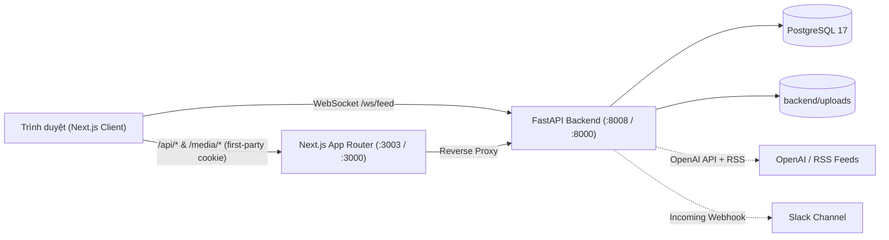
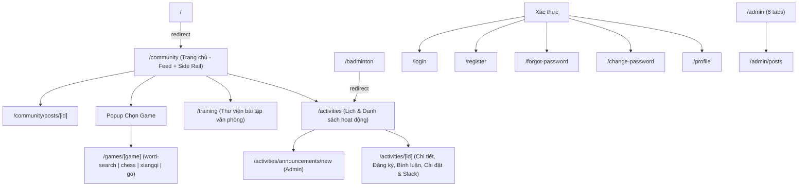
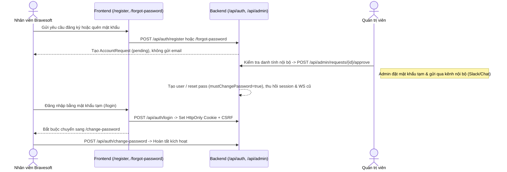
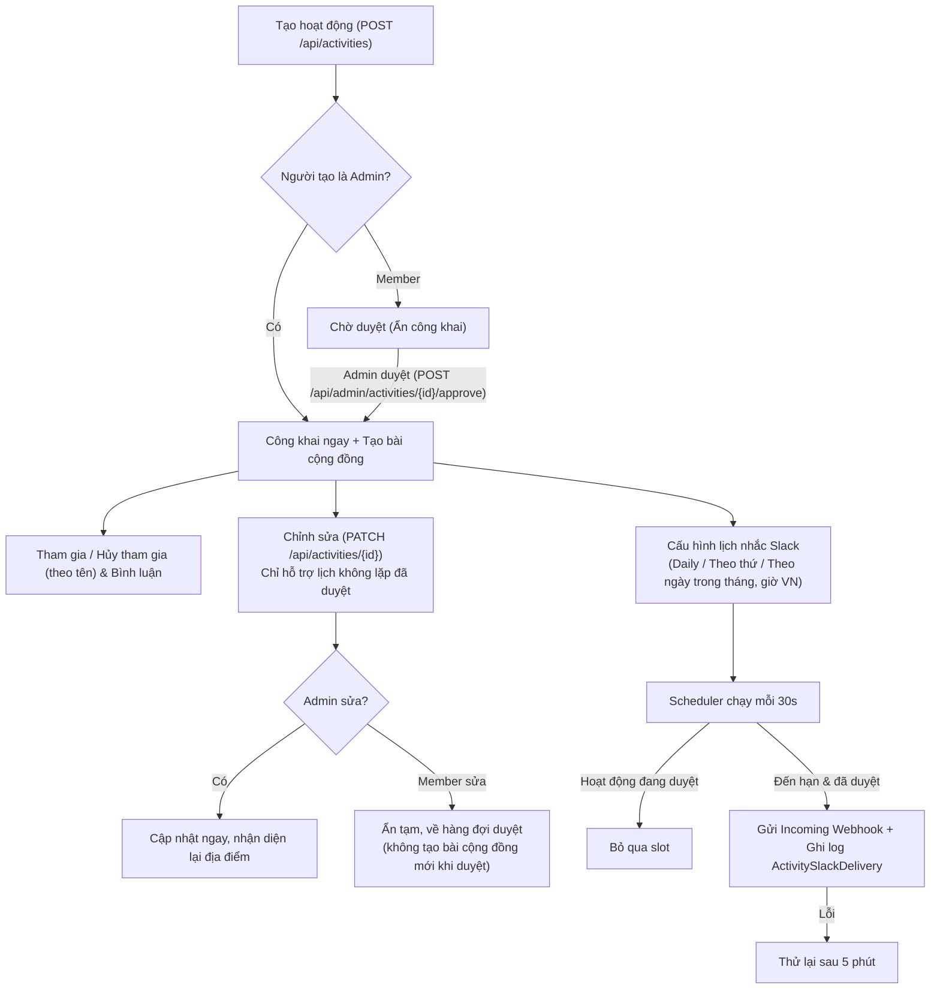

# braveActive Club — Khái niệm & Luồng hoạt động Web

Tài liệu này tổng hợp khái niệm sản phẩm, kiến trúc kỹ thuật, ma trận phân quyền, bản đồ trang và các luồng nghiệp vụ chính của **braveActive Club** dựa trên mã nguồn (`frontend/`, `backend/`), [README.md](../README.md), [AGENTS.md](../AGENTS.md) và [frontend/AGENTS.md](../frontend/AGENTS.md).

---

## 1. Khái niệm sản phẩm (Product Concept)

**braveActive Club** là cổng thông tin & mạng xã hội nội bộ dành cho thành viên **Bravesoft** (`@bravesoft.vn`, `@bravesoft.com.vn`), kết hợp 4 trụ cột:

1. **Cộng đồng (`/community`)**: Bảng tin nội bộ thời gian thực (đăng bài, ảnh, link preview, thích, bình luận, nhắc thông báo, trạng thái online) và các bài tóm tắt tin tức do **braveActive AI** tạo từ RSS.
2. **Hoạt động CLB (`/activities`)**: Lịch sự kiện thể thao/CLB (đơn lẻ hoặc lặp định kỳ), đăng ký tham gia theo tên, bình luận, kiểm duyệt tạo/sửa hoạt động và nhắc lịch tự động qua **Slack Incoming Webhook**.
3. **Thư viện tập luyện (`/training`)**: Danh mục bài tập vận động nhẹ tại văn phòng (cổ-vai, tay-chân, toàn thân) hoàn toàn public, đa ngôn ngữ (`vi` / `en` / `ja`), có hình minh họa SVG động (hỗ trợ pause/play và `prefers-reduced-motion`), không cần đăng nhập hay gọi backend.
4. **Giải trí & Gamification (`/games/<game>`)**: 4 trò chơi (Tìm từ vận động tạo bằng OpenAI, Cờ vua, Cờ tướng, Cờ vây đánh với máy) đi kèm hệ thống điểm theo từng game, check-in hằng ngày, chuỗi ngày (streak) và bảng xếp hạng tuần/tháng.

> **Đa ngôn ngữ & Giao diện**: Hỗ trợ 3 ngôn ngữ (`vi`, `en`, `ja`) trong `frontend/src/i18n/messages/` và chuyển đổi theme sáng/tối.

---

## 2. Kiến trúc hệ thống & Quy ước kỹ thuật

- **Frontend** (`frontend/`): Next.js App Router, TypeScript strict, alias `@/*` -> `frontend/src/*`. Proxy `/api` và `/media` về backend để giữ session cookie `HttpOnly` + `SameSite` ở chế độ first-party.
- **Backend** (`backend/`): FastAPI + SQLAlchemy async + Alembic migration (`backend/alembic/versions/`), **không dùng Redis**.
- **Single Worker**: Chạy đúng 1 backend worker vì WebSocket Hub & Presence lưu trong bộ nhớ (`in-memory`); thông báo offline được lưu trong PostgreSQL.
- **3 Background Schedulers** khởi chạy trong `lifespan` tại [backend/app/main.py](../backend/app/main.py):
  1. `_recurrence_loop` (mỗi 6 giờ): sinh các buổi tiếp theo cho hoạt động lặp định kỳ.
  2. `_ai_post_schedule_loop` (mỗi 30 giây): tự động tạo bài draft AI theo khung giờ VN (`08:00`, `08:30`, `12:00`, `16:00`, `17:30`).
  3. `_slack_schedule_loop` (mỗi 30 giây): kiểm tra và gửi thông báo nhắc lịch hoạt động qua Slack Webhook.
- **Bảo mật**: Cookie session `HttpOnly`, CSRF token gắn với session cho mọi ghi có xác thực, kiểm tra `Origin`, rate limiting, kiểm tra SSRF/protocol/size cho link preview, xác thực & re-encode ảnh upload.

---

## 3. Phân quyền & Vai trò (Roles & Permissions)

| Vai trò | Phạm vi truy cập & Quyền hạn |
| :--- | :--- |
| **Guest** (Chưa đăng nhập) | Xem feed công khai, xem chi tiết bài viết/hoạt động đã duyệt, dùng `/training`, chơi `/games/*` (check-in/hint lưu ở trình duyệt, không lên BXH), gửi yêu cầu đăng ký/đặt lại mật khẩu. |
| **Member** (`role = "user"`) | Tất cả quyền Guest + đăng/sửa/xóa bài viết của mình, thích & bình luận, đề xuất hoạt động mới (chờ duyệt), sửa/xóa/cấu hình Slack cho hoạt động mình tạo, nhận thông báo realtime & inbox, tham gia bảng xếp hạng game, gửi feedback, quản lý hồ sơ & avatar. |
| **Admin** (`role = "admin"`) | Toàn quyền Member + tạo/sửa hoạt động duyệt ngay, quản lý thông báo (announcements), tạo & duyệt bài `braveActive AI`, truy cập `/admin` (quản lý user, duyệt yêu cầu tài khoản, kiểm duyệt bài viết, duyệt hoạt động, xem feedback, quản lý/tạm dừng lịch Slack & lịch sử gửi). |

---

## 4. Bản đồ điều hướng (Sitemap)

---

## 5. Các luồng nghiệp vụ chính (Core Flows)

### Flow 1: Xác thực & Vòng đời tài khoản (No-Email Manual Approval)

Hệ thống **không gửi email tự động** và chỉ chấp nhận domain `@bravesoft.vn` hoặc `@bravesoft.com.vn` ([backend/app/api/routes/auth.py](../backend/app/api/routes/auth.py)).

### Flow 2: Cộng đồng, Realtime & Thông báo

- **Feed**: [community-page.tsx](../frontend/src/components/community/community-page.tsx) tải danh sách bài viết phân trang (`GET /api/posts`), kèm [community-side-rail.tsx](../frontend/src/components/community/community-side-rail.tsx) (lịch mini liên kết `/activities?date=...`, lối tắt `/training` và popup game).
- **Đăng bài & Tương tác**: Member đăng bài kèm text/ảnh/URL (backend tự quét link preview an toàn), thích (`PUT/DELETE /api/posts/{id}/like`), bình luận (`POST /api/posts/{id}/comments`).
- **AI Reply**: Khi có bình luận trên bài `braveActive AI` đã duyệt (và `OPENAI_API_KEY` được cấu hình), hệ thống có thể phản hồi tự động bằng AI.
- **Realtime (`/ws/feed`)**: Khi có bài mới, like hoặc comment, WebSocket đẩy sự kiện trực tiếp tới client đang kết nối; đồng thời cập nhật badge bài chưa đọc trên [site-chrome.tsx](../frontend/src/components/layout/site-chrome.tsx), chuông thông báo [notification-bell.tsx](../frontend/src/components/layout/notification-bell.tsx) (lưu PostgreSQL cho offline) và trạng thái online (`GET /api/presence`).

### Flow 3: Hoạt động CLB, Kiểm duyệt sửa đổi & Nhắc lịch Slack

- **Hoạt động lặp định kỳ**: Lưu quy tắc tại `activity_recurrences`; job nền chạy mỗi 6 giờ (hoặc kích hoạt qua `GET /api/cron/activity-recurrences`) để sinh các buổi sắp tới.
- **Quản trị Slack**: Admin xem toàn bộ lịch, tạm dừng/tiếp tục (bỏ qua slot đã lỡ khi tiếp tục), xem lịch sử gửi phân trang tại tab Slack của `/admin`. Hủy lịch hoặc xóa hoạt động sẽ lưu trữ (archive) lịch sử.

### Flow 4: Nội dung AI tự động (RSS -> Pending Draft -> Publish)

1. **Tự động theo lịch (giờ VN)**: Backend kiểm tra mỗi 30 giây các khung giờ `08:00`, `08:30` (Công nghệ), `12:00` (Du lịch/Thể thao/Giải trí), `16:00` (Thể thao/Giải trí/Công nghệ), `17:30` (chỉ các nguồn AI như GenK AI, TechCrunch AI, VentureBeat AI, OpenAI, Google AI). Trạng thái mỗi slot lưu trong `ai_post_schedule_runs` để tránh trùng lặp; lỗi tạm thời thử lại tối đa 3 lần cách nhau 5 phút.
2. **Thủ công bởi Admin**: Admin chọn chủ đề + khung thời gian mới (`1h / 4h / 12h / 24h`) -> `POST /api/admin/ai-posts/preview` để xem & chỉnh sửa bản tóm tắt tiếng Việt -> `POST /api/admin/ai-posts/publish` đưa vào hàng chờ duyệt -> duyệt công khai lên feed cộng đồng.
3. **Chống trùng nguồn**: Chuẩn hóa URL RSS (bỏ tracking params) và đối chiếu với các link đã dùng.

### Flow 5: Trò chơi giải trí & Bảng xếp hạng (`/games/[game]`)

- **Word Search (`/games/word-search`)**: OpenAI sinh 3–5 câu hỏi/từ khóa theo độ khó (`easy`: 100đ, `medium`: 250đ, `hard`: 500đ), tự sinh bảng chữ không dấu khớp với đáp án có dấu, giới hạn 5 lần tạo/IP/giờ. Member có 2 gợi ý miễn phí/ngày (giờ VN), các gợi ý sau tốn 100 điểm Word Search.
- **Cờ vua / Cờ tướng / Cờ vây (`/games/chess`, `xiangqi`, `go`)**: Đấu với máy qua backend ([board_games.py](../backend/app/services/board_games.py)); thắng nhận `100 / 200 / 500` điểm theo độ khó, hòa/thua 0 điểm.
- **Check-in & Leaderboard**: Hoàn thành ván chơi tự động check-in ngày (giờ VN) để tích lũy streak. Điểm & bảng xếp hạng tuần/tháng được tính riêng cho từng game; Guest chỉ lưu cục bộ trên trình duyệt và không vào BXH.

### Flow 6: Thư viện tập luyện (`/training`)

- Dữ liệu tĩnh trong [training.ts](../frontend/src/lib/training.ts) gồm 3 nhóm (Cổ & Vai, Tay & Chân, Toàn thân), sắp xếp theo độ khó tương đối (`gentle` -> `basic` -> `advanced`).
- Nhấn vào thẻ bài tập mở modal [exercise-animation.tsx](../frontend/src/components/training/exercise-animation.tsx) hiển thị bước chuẩn bị, hướng dẫn từng bước, lưu ý an toàn và hình SVG động (nút tạm dừng/phát, tắt chuyển động nếu người dùng bật `reduced-motion`).

### Flow 7: Bảng điều khiển Quản trị (`/admin`)

[admin-page.tsx](../frontend/src/components/admin/admin-page.tsx) gom 6 tab quản trị tập trung:

1. **Users**: Tạo, sửa vai trò/tên, xóa tài khoản (xóa user sẽ xóa toàn bộ bài viết, comment, like của user đó; đăng ký hoạt động giữ nguyên vì lưu theo tên).
2. **Requests**: Duyệt (kèm cấp mật khẩu tạm) hoặc từ chối yêu cầu đăng ký & đặt lại mật khẩu.
3. **Posts**: Kiểm duyệt bài đăng (bao gồm bài AI pending), ẩn/hiện hoặc xóa bài, mở hộp thoại tạo bài AI.
4. **Activities**: Xem danh sách hoạt động & hàng chờ duyệt (tạo mới hoặc chỉnh sửa từ Member).
5. **Slack**: Quản lý trạng thái (pause/resume) các lịch thông báo Slack và tra cứu lịch sử gửi.
6. **Feedback**: Xem góp ý gửi từ widget phản hồi toàn trang.

---

## 6. Bản đồ nhanh mã nguồn & Bảng dữ liệu

| Module | Backend Route & Service | ORM Models (PostgreSQL) | Frontend chính |
| :--- | :--- | :--- | :--- |
| **Auth & User** | `routes/auth.py`, `services/auth.py` | `users`, `user_sessions`, `account_requests`, `password_reset_tokens`, `email_verifications` | `components/auth/*`, `app/login`, `register`, `profile` |
| **Community & Realtime** | `routes/community.py`, `services/community.py`, `realtime.py`, `notifications.py`, `link_preview.py` | `posts`, `post_likes`, `post_comments`, `notifications`, `feedback` | `components/community/*`, `lib/use-community-feed.ts`, `use-feed-events.ts` |
| **AI Content** | `routes/admin.py`, `services/ai_content.py`, `ai_post_scheduler.py` | `ai_post_schedule_runs`, `posts` | `components/community/admin-ai-post-dialog.tsx` |
| **Activities & Slack** | `routes/activities.py`, `routes/content.py`, `services/activities.py`, `slack_notifications.py` | `activities`, `activity_participants`, `activity_votes`, `activity_comments`, `activity_recurrences`, `announcements`, `activity_slack_schedules`, `activity_slack_deliveries` | `components/club/*`, `components/admin/admin-activities-panel.tsx`, `admin-slack-panel.tsx` |
| **Games** | `routes/community.py` (`/games/*`), `services/board_games.py`, `game_scores.py` | `game_rounds`, `game_daily_activities` | `components/games/*`, `lib/word-search.ts`, `app/games/[game]` |
| **Training** | Không dùng backend | Không dùng DB | `components/training/*`, `lib/training.ts`, `app/training` |

---

## 7. Quy trình chạy & kiểm thử nhanh (từ `AGENTS.md`)

- **Chạy local (Docker)**: `docker compose up --build -d` (FE: `http://localhost:3003`, BE: `http://localhost:8008/health`).
- **Chạy local (không Docker)**: `bash scripts/run.sh` (FE: `http://localhost:3000`, BE: `http://localhost:8000`).
- **Kiểm thử**:
  - Backend: `docker compose --profile test run --rm backend-tests` (chạy trên DB tạm tmpfs; tuyệt đối không trỏ `TEST_DATABASE_URL` vào DB chính).
  - Frontend: `node --test frontend/tests/*.test.mjs`.
- **Lưu ý phát triển**:
  - Sửa nội dung hiển thị phải cập nhật đủ 3 bản dịch `en.ts`, `ja.ts`, `vi.ts`.
  - Thay đổi schema DB phải đi kèm migration Alembic trong `backend/alembic/versions/`.
  - Đọc tài liệu Next.js trong `frontend/node_modules/next/dist/docs/` khi thay đổi API/convention Next.js.
  - Không chạy `docker compose down -v` nếu chưa được yêu cầu rõ ràng.
